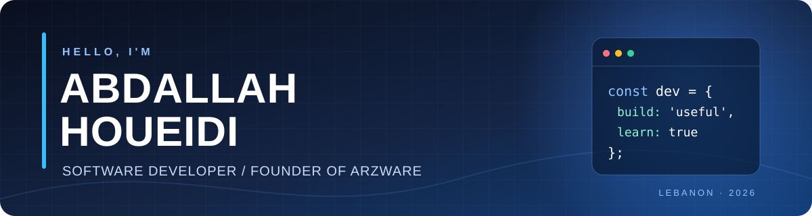

<!-- GitHub Profile README | Abdallah Houeidi -->

  

  
<strong>Computer Science Student</strong> · <strong>Software Developer</strong> · <strong>Founder of Arzware</strong>

  
Building practical digital solutions: responsive websites, APIs, databases, and business tools.

  
  
  
  

  
<a href="#about-me">About</a> · <a href="#technical-toolkit">Skills</a> · <a href="#featured-projects">Projects</a> · <a href="#experience">Experience</a> · <a href="#education--training">Education</a> · <a href="#connect">Contact</a>

---

## About me

I'm **Abdallah Houeidi**, a Computer Science student at **Lebanese International University** and the founder of **[Arzware](https://arzware.net)**, focused on practical digital solutions for small and medium businesses.

- **Software development:** Responsive web applications, REST APIs, and relational and document databases.
- **Entrepreneurship:** Building Arzware's offerings around websites, digital menus, ordering and contact flows, automation, and custom software.
- **IT experience:** Computer maintenance, troubleshooting, and customer-facing technical support at CLICKONCE.
- **Career goal:** Seeking software development internship opportunities to continue growing as an engineer.

## Technical toolkit

**Programming & frontend**

**Backend & databases**

**Tools, systems & networking**

Additional foundations: **TCP/IP, subnetting, routing and switching, computer maintenance, and software troubleshooting.**

## Featured projects

### 01 — Ember Café POS
**HTML · CSS · JavaScript**

Responsive café point-of-sale interface with product browsing, an interactive cart, subtotal and tax calculations, and an order-completion flow. Includes animated menu-to-cart feedback and separate HTML, CSS, and JavaScript files.

### 02 — TimeBank Community Platform
**React · Node.js · Express · MongoDB**

Contributed to a team platform for exchanging services using time credits. Worked on backend structure and authenticated profile updates, including controlled React forms, API requests, local storage, and application state.

### 03 — University Course Registration Database
**MySQL · SQL · XAMPP**

Designed a relational database for departments, students, instructors, courses, sections, and enrollments. Wrote SQL joins, aggregations, filtering, and pagination queries for academic reporting.

## Experience

| Role | Organization | Period |
| :--- | :--- | :--- |
| **Founder & Owner** | [Arzware](https://arzware.net) | June 2026 – Present |
| **IT Support Technician & Sales Associate** | CLICKONCE | May 2025 – Present |

At **Arzware**, I work on responsive websites, business interfaces, and digital service offerings. At **CLICKONCE**, I troubleshoot software issues, maintain computers, support customers, and explain technical solutions.

## Education & training

- **B.S. in Computer Science** — Lebanese International University · *Expected December 2027*
- **LT in Information Technology** — Amjad Institute · *GPA: 3.5*
- **Web Development Training** — Digital Hub by UNRWA · *Team development, Git and GitHub collaboration, presentations, and professional communication*

**Certifications listed in my CV:** Linux Essentials · IT Essentials · CCNA v7 · Cybersecurity

## Connect

Interested in collaborating on a project, discussing an internship, or learning more about Arzware?

Based in Lebanon · Arabic (native) · English (professional working proficiency)
